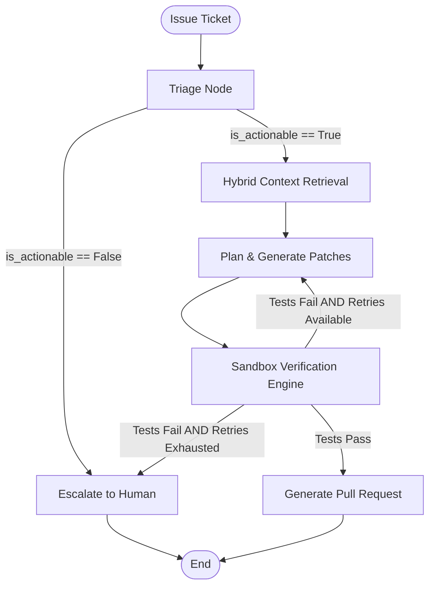

# AutoPR: Autonomous AI Software Engineering Agent

[](https://www.python.org/downloads/release/python-3120/)
[](https://docs.astral.sh/uv/)
[](https://github.com/langchain-ai/langgraph)
[](https://docs.pytest.org/)

**AutoPR** is an autonomous AI agent engineered to resolve GitHub issue tickets and generate production-ready Pull Requests. Built using **LangGraph** and powered by **Google Gemini**, it runs an iterative cycle of triage, hybrid code retrieval, solution planning, code patching, and sandbox verification.

---

## Architecture at a Glance

Unlike single-pass code generators, AutoPR uses an isolated sandbox test loop to self-correct and verify code before creating a PR:



---

## Key Features

- **Automated Issue Triage**: Evaluates whether an issue is clearly specified and reproducible before spending compute.
- **Hybrid Lexical + Semantic Code Search**: Combines AST-based Python parsing, BM25 exact identifier matching, and dense vector embeddings (`BAAI/bge-small-en-v1.5`) blended via Reciprocal Rank Fusion ($k=60$).
- **Iterative Repair Feedback Loop**: Automatically ingests pytest exit codes, failing test names, and stderr to fix bugs across iterative retry attempts.
- **Isolated Execution Sandbox**: Runs test suites inside isolated ephemeral workspaces with timeout guards.

---

## Quickstart

### Prerequisites
- Python >= 3.12
- [uv](https://docs.astral.sh/uv/)
- Google Gemini API key (`GOOGLE_API_KEY`)

### Setup

```bash
git clone https://github.com/sherbinator/autopr.git
cd autopr
uv sync
export GOOGLE_API_KEY="your-api-key"
```

### Running AutoPR

```python
from autopr.graph import app
from autopr.state import AgentState

initial_state: AgentState = {
    "ticket_id": "ENG-101",
    "issue_description": "Fix off-by-one error in calculator.py add function",
    "target_repo_path": "./",
    "is_actionable": False,
    "triage_notes": "",
    "retry_count": 0,
    "max_retries": 3,
    "retrieved_docs": [],
    "plan": None,
    "patches": [],
    "verification_result": None,
    "pr_ready": False,
}

result = app.invoke(initial_state)

if result.get("pr_ready"):
    print("Pull Request Ready!")
    print(result.get("triage_notes"))
```

### Running Tests

```bash
uv run pytest -v
```

---

## Documentation

Full documentation is available in the [`docs/`](docs/) directory:

- [**Project Overview**](docs/overview.md): Motivation, capabilities, and tech stack
- [**Getting Started & Usage**](docs/getting-started.md): Setup, environment variables, and usage guide
- [**Architecture & System Design**](docs/architecture.md): State machine lifecycle, hybrid retrieval engine, sandbox execution, and schemas
