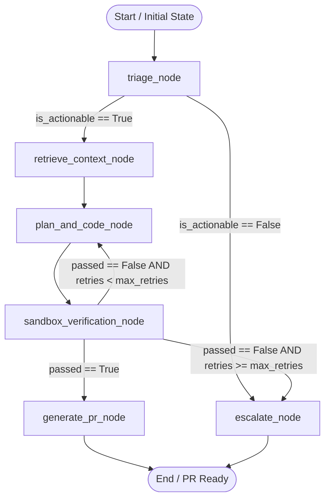
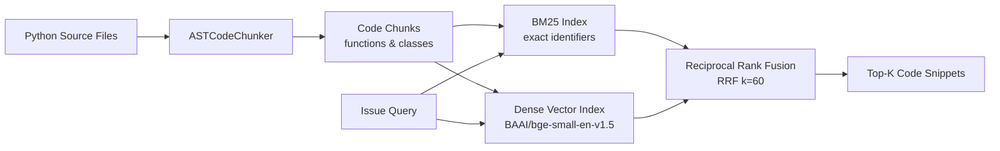

# Architecture & System Design: AutoPR

This document provides a comprehensive technical overview of AutoPR's architecture, state machine workflow, hybrid retrieval system, sandbox execution sandbox, and data contracts.

---

## 1. System Overview & Philosophy

Traditional coding agents execute linear prompts (prompt $\rightarrow$ code $\rightarrow$ output). When generated code contains bugs, syntax errors, or regression failures, linear workflows fail. 

AutoPR operates as a **cyclic, stateful feedback machine** orchestrated via [LangGraph](https://github.com/langchain-ai/langgraph). The core philosophy is **test-driven agentic synthesis**: code is never committed or published as a pull request until it demonstrably passes automated test suites in an isolated sandbox.

---

## 2. Graph Lifecycle & State Machine

The workflow is defined as a `StateGraph(AgentState)` in [`src/autopr/graph.py`](file:///home/sherby/development/portfolio/ai/autopr/src/autopr/graph.py).



### Graph Routing Logic

1. **`route_triage(state: AgentState)`**:
   - Inspects `state["is_actionable"]`.
   - Returns `"retrieve_context_node"` if `True`; otherwise routes to `"escalate_node"`.

2. **`route_verification(state: AgentState)`**:
   - Inspects `state["verification_result"]` and `state["retry_count"]`.
   - If tests passed (`result.passed == True`), routes to `"generate_pr_node"`.
   - If tests failed and `retry_count < max_retries`, loops back to `"plan_and_code_node"` with failure execution traces.
   - If tests failed and `retry_count >= max_retries`, routes to `"escalate_node"`.

---

## 3. Node Specifications & Responsibilities

### 3.1 Triage Node (`src/autopr/nodes/triage.py`)
- **Purpose**: Evaluates whether an issue contains enough concrete specification to reproduce and resolve.
- **Model**: `gemini-3.1-flash-lite` via `ChatGoogleGenerativeAI(temperature=0)`.
- **Output Schema**: `TriageDecision` (`is_actionable: bool`, `notes: str`).
- **Behavior**: Rejects vague issues early to conserve compute and prevent hallucinations.

### 3.2 Context Retrieval Node (`src/autopr/nodes/context.py`)
- **Purpose**: Gathers the most relevant code chunks from the codebase using the ticket ID and issue description.
- **Retriever**: Queries `HybridCodeRetriever.search(query, top_k=4)`.
- **Output**: Populates `state["retrieved_docs"]` with formatted markdown code blocks detailing file paths, line ranges, symbol names, and source snippets.

### 3.3 Solution Planning & Coder Node (`src/autopr/nodes/coder.py`)
- **Purpose**: Synthesizes a technical implementation plan and full replacement source code patches for target files.
- **Model**: `gemini-3.1-flash-lite` with structured output schema `CodePlanAndPatch` (`plan: str`, `patches: list[FilePatch]`).
- **Failure Trace Ingestion**: When executing in a retry cycle (`verification_result.passed == False`), extracts:
  - Exit code
  - List of failing pytest test identifiers (`failing_test_names`)
  - Standard error / standard output trace
  These are injected directly into the `{failure_context}` prompt variable so the model understands exactly why previous attempts failed.

### 3.4 Sandbox Verification Node (`src/autopr/nodes/verifier.py`)
- **Purpose**: Tests proposed patches in an isolated environment using `SandboxExecutionEngine`.
- **Behavior**:
  - Clones the target workspace to a temporary isolated directory.
  - Applies all proposed `FilePatch` diffs.
  - Executes the test suite command (`pytest -q`) under strict timeout enforcement (default: 45s).
  - Updates `state["verification_result"]` (`ExecutionResult`) and increments `state["retry_count"]`.

### 3.5 PR Generation Node (`src/autopr/nodes/pr.py`)
- **Purpose**: Assembles a pull request summary upon verification success.
- **Output**: Sets `state["pr_ready"] = True` and writes a GitHub-ready markdown PR description detailing the plan, modified files, verification status, and retry cycles.

### 3.6 Escalation Node (`src/autopr/nodes/pr.py`)
- **Purpose**: Graceful fallback when an issue is rejected by triage or exceeds its retry budget.
- **Output**: Sets `state["pr_ready"] = False` and documents reasons for human engineering review.

---

## 4. Hybrid Code Retrieval Engine

To avoid token bloat and ensure precise context, AutoPR utilizes a multi-stage hybrid retrieval pipeline combining syntactic parsing, lexical search, and semantic embeddings.



### 4.1 AST Chunking (`src/autopr/retrieval/ast_chunker.py`)
Rather than naive fixed-character chunking, `ASTCodeChunker` parses Python files into `CodeChunk` objects based on grammatical AST boundaries:
- Functions (`ast.FunctionDef`, `ast.AsyncFunctionDef`)
- Classes (`ast.ClassDef`)
- Captures `symbol_name`, `chunk_type`, `start_line`, and `end_line`.

### 4.2 Sparse BM25 Search
- Tokenizes source chunks and queries with `rank_bm25.BM25Okapi`.
- Excels at exact identifier matches (e.g., function names, variable names, error codes).

### 4.3 Dense Semantic Search
- Encodes chunk content using `SentenceTransformer("BAAI/bge-small-en-v1.5")`.
- Computes cosine similarity between normalized query embeddings and corpus vectors.
- Captures conceptual and semantic intent (e.g., "authentication failure" matching `def verify_token(...)`).

### 4.4 Reciprocal Rank Fusion (RRF)
Blends ranked results from sparse and dense retrievers into a unified score:

$$RRF(d) = \sum_{m \in \{\text{BM25}, \text{Dense}\}} \frac{1}{k + r_m(d)}$$

Where $k = 60$ and $r_m(d)$ is the 1-based rank position of document $d$ within retriever $m$.

---

## 5. Isolated Sandbox Execution Engine

The execution runner in [`src/autopr/tools/sandbox.py`](file:///home/sherby/development/portfolio/ai/autopr/src/autopr/tools/sandbox.py) safeguards the host environment while verifying patches.

### Key Capabilities
1. **Ephemeral Workspace Replication**: Clones the base repo to an isolated temporary directory (`tempfile.TemporaryDirectory`).
2. **Atomic Patch Application**: Writes modified files into the replica using `FilePatch.file_path` and `FilePatch.diff`.
3. **Execution Guardrails**: Runs tests via `subprocess.run` with timeout enforcement (`timeout_seconds`, default 30–45s) to guard against infinite loops.
4. **Pytest Failure Parsing**: Scans test output line-by-line:
   ```python
   # Extracts failing test node: "tests/test_auth.py::test_login"
   if line.startswith("FAILED ") and "::" in line:
       parts = line.split()
       failing.append(parts[1])
   ```

---

## 6. Data Models & Schemas

### `AgentState` ([src/autopr/state.py](file:///home/sherby/development/portfolio/ai/autopr/src/autopr/state.py))
```python
class AgentState(TypedDict):
    ticket_id: str
    issue_description: str
    target_repo_path: str
    is_actionable: bool
    triage_notes: str
    retry_count: int
    max_retries: int
    retrieved_docs: Annotated[list[str], operator.add]
    plan: str | None
    patches: list[FilePatch]
    verification_result: ExecutionResult | None
    pr_ready: bool
```

### `FilePatch` & `ExecutionResult` ([src/autopr/state.py](file:///home/sherby/development/portfolio/ai/autopr/src/autopr/state.py))
```python
class FilePatch(BaseModel):
    file_path: str = Field(description="Target file relative path")
    diff: str = Field(description="Unified git diff or complete file contents")

class ExecutionResult(BaseModel):
    passed: bool
    exit_code: int
    stdout: str
    stderr: str
    failing_test_names: list[str] = Field(default_factory=list)
```
